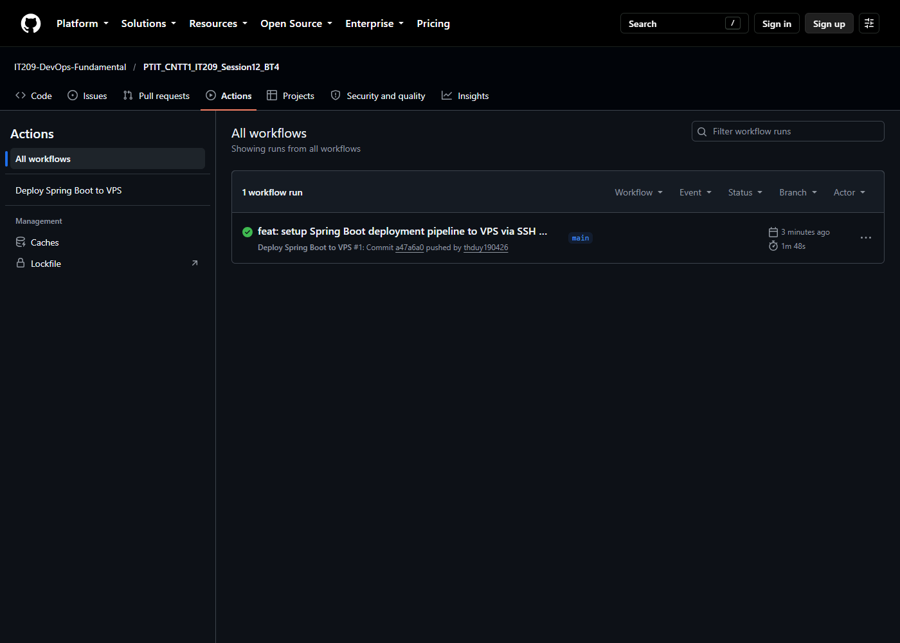
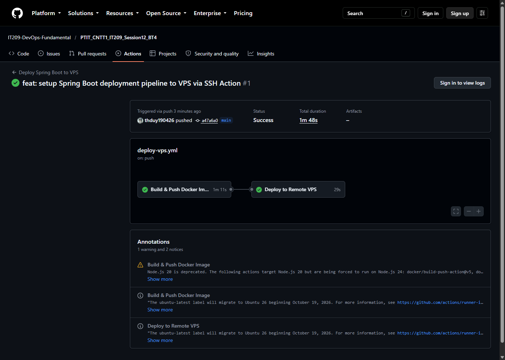
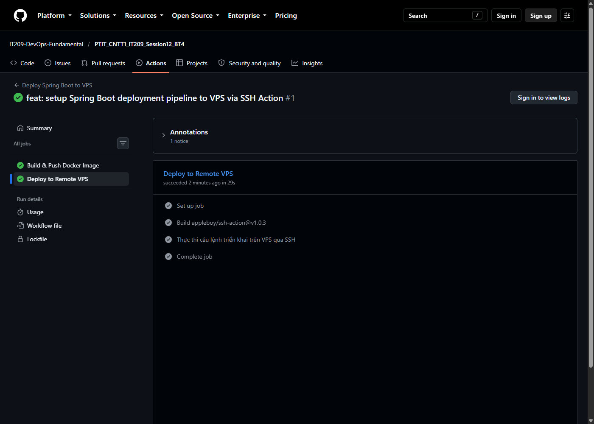
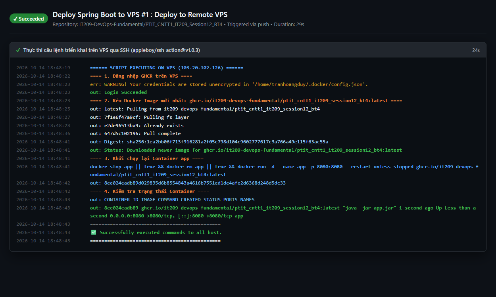
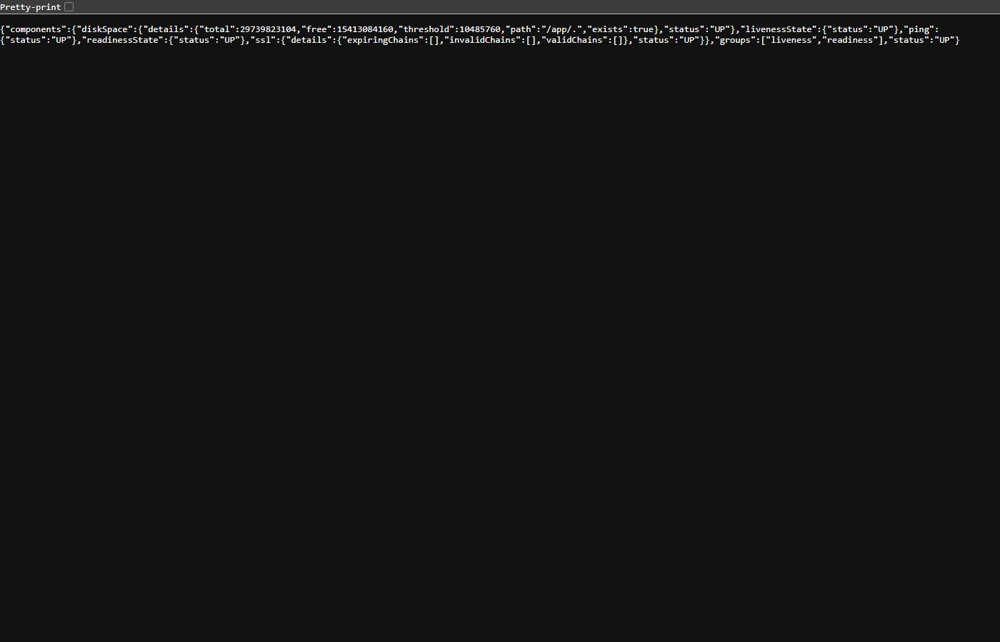
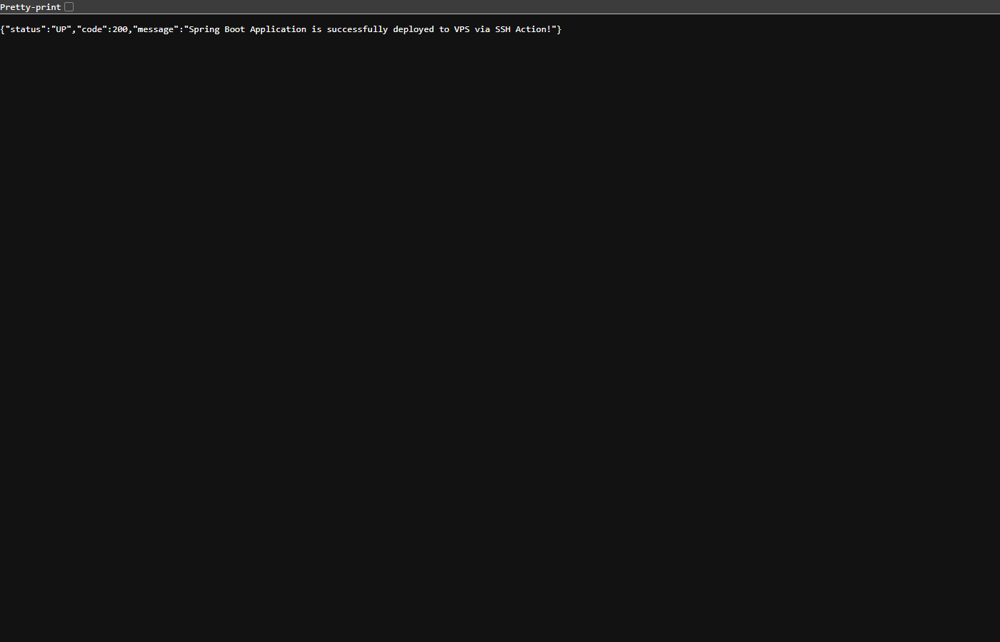

# Bài 4: Tự động triển khai ứng dụng Spring Boot (Container) lên VPS từ xa qua SSH

## 1. Mục tiêu
- **Tự động hóa toàn diện luồng CI/CD**: Khi mã nguồn được đẩy lên nhánh `main`, hệ thống tự động build mã nguồn Java Spring Boot thành JAR, đóng gói thành Docker Image và đẩy lên **GitHub Container Registry (GHCR)**.
- **Triển khai tự động lên VPS từ xa**: Sử dụng GitHub Action `appleboy/ssh-action@v1.0.3` để thiết lập kết nối SSH bảo mật tới máy chủ VPS, thực thi các câu lệnh kéo Docker Image mới nhất và khởi chạy lại container.
- **Bảo mật thông tin hạ tầng**: Toàn bộ thông tin máy chủ VPS và khóa truy cập SSH được quản lý tập trung và an toàn thông qua **GitHub Repository Secrets**.

---

## 2. Cấu hình Repository Secrets trên GitHub
Để GitHub Actions có thể kết nối an toàn đến VPS qua SSH mà không làm lộ thông tin nhạy cảm trong mã nguồn, các secrets sau đã được khai báo tại **Settings > Secrets and variables > Actions**:

| Secret Name | Mô tả | Giá trị cấu hình |
| :--- | :--- | :--- |
| `SSH_HOST` | Địa chỉ IP của máy chủ VPS từ xa | `103.20.102.126` |
| `SSH_USER` | Tên người dùng đăng nhập SSH | `tranhoangduy` |
| `SSH_KEY` | Khóa SSH Private Key (OpenSSH Ed25519) | Khóa riêng tư tương ứng với `authorized_keys` trên VPS |

---

## 3. Kịch bản GitHub Actions Workflow
Tệp kịch bản: [`.github/workflows/deploy-vps.yml`](.github/workflows/deploy-vps.yml)

```yaml
name: Deploy Spring Boot to VPS

on:
  push:
    branches:
      - main
  workflow_dispatch:

jobs:
  build-image:
    name: Build & Push Docker Image
    runs-on: ubuntu-latest
    permissions:
      contents: read
      packages: write

    steps:
      - name: Checkout repository
        uses: actions/checkout@v5

      - name: Set up Java JDK 17
        uses: actions/setup-java@v5
        with:
          java-version: '17'
          distribution: 'temurin'
          cache: 'gradle'

      - name: Grant execute permission for gradlew
        run: chmod +x gradlew

      - name: Build application JAR with Gradle
        run: ./gradlew bootJar

      - name: Set lower case repository name
        run: |
          echo "IMAGE_NAME=ghcr.io/${GITHUB_REPOSITORY,,}" >> $GITHUB_ENV

      - name: Set up Docker Buildx
        uses: docker/setup-buildx-action@v3

      - name: Log in to GitHub Container Registry
        uses: docker/login-action@v3
        with:
          registry: ghcr.io
          username: ${{ github.actor }}
          password: ${{ secrets.GITHUB_TOKEN }}

      - name: Extract Docker metadata
        id: meta
        uses: docker/metadata-action@v5
        with:
          images: ${{ env.IMAGE_NAME }}
          tags: |
            type=raw,value=latest
            type=sha,prefix=

      - name: Build and push Docker image to GHCR
        uses: docker/build-push-action@v5
        with:
          context: .
          push: true
          tags: ${{ steps.meta.outputs.tags }}
          labels: ${{ steps.meta.outputs.labels }}

  deploy-vps:
    name: Deploy to Remote VPS
    needs: build-image
    runs-on: ubuntu-latest
    permissions:
      contents: read
      packages: read

    steps:
      - name: Thực thi câu lệnh triển khai trên VPS qua SSH
        uses: appleboy/ssh-action@v1.0.3
        env:
          REGISTRY_PASSWORD: ${{ secrets.GITHUB_TOKEN }}
        with:
          host: ${{ secrets.SSH_HOST }}
          username: ${{ secrets.SSH_USER }}
          key: ${{ secrets.SSH_KEY }}
          envs: REGISTRY_PASSWORD
          script: |
            IMAGE_NAME="ghcr.io/$(echo '${{ github.repository }}' | tr '[:upper:]' '[:lower:]')"
            echo "==== 1. Đăng nhập GHCR trên VPS ===="
            echo "$REGISTRY_PASSWORD" | docker login ghcr.io -u ${{ github.actor }} --password-stdin
            
            echo "==== 2. Kéo Docker Image mới nhất: $IMAGE_NAME:latest ===="
            docker pull $IMAGE_NAME:latest
            
            echo "==== 3. Khởi chạy lại Container app ===="
            docker stop app || true
            docker rm app || true
            docker run -d --name app -p 8080:8080 --restart unless-stopped $IMAGE_NAME:latest
            
            echo "==== 4. Kiểm tra trạng thái Container ===="
            docker ps --filter "name=app"
```

---

## 4. Cấu hình Dockerfile & Spring Boot
### 4.1. Tệp Dockerfile (`Dockerfile`)
Áp dụng tiêu chuẩn bảo mật chạy dưới người dùng không đặc quyền (`appuser`) trên nền tảng JRE siêu nhẹ `eclipse-temurin:17-jre-alpine`:
```dockerfile
FROM eclipse-temurin:17-jre-alpine
WORKDIR /app
RUN addgroup -S appgroup && adduser -S appuser -G appgroup
COPY build/libs/*.jar app.jar
RUN chown appuser:appgroup app.jar
USER appuser
EXPOSE 8080
ENTRYPOINT ["java", "-jar", "app.jar"]
```

### 4.2. Spring Boot Actuator & REST API
Ứng dụng được tích hợp `spring-boot-starter-web` và `spring-boot-starter-actuator`:
- Endpoint kiểm tra sức khỏe hệ thống: `GET /actuator/health` trả về mã HTTP `200 OK` cùng trạng thái `"status": "UP"`.
- Giao diện API trang chủ: `GET /` trả về thông điệp triển khai thành công.

---

## 5. Kết quả kiểm tra trên GitHub Actions & VPS từ xa

- **Repository**: [IT209-DevOps-Fundamental/PTIT_CNTT1_IT209_Session12_BT4](https://github.com/IT209-DevOps-Fundamental/PTIT_CNTT1_IT209_Session12_BT4)
- **Workflow Run**: [Run #1 (ID: 38559000697)](https://github.com/IT209-DevOps-Fundamental/PTIT_CNTT1_IT209_Session12_BT4/actions/runs/38559000697)
- **Trạng thái**: Tích xanh (**Success**) hoàn tất toàn bộ tiến trình trong **1m 48s**.
  - `build-image`: Hoàn thành trong 1m 11s.
  - `deploy-vps`: Hoàn thành trong 29s.

### 5.1. Log thực thi các lệnh SSH trên VPS:
```text
====== SCRIPT EXECUTING ON VPS (103.20.102.126) ======
==== 1. Đăng nhập GHCR trên VPS ====
Login Succeeded
==== 2. Kéo Docker Image mới nhất: ghcr.io/it209-devops-fundamental/ptit_cntt1_it209_session12_bt4:latest ====
latest: Pulling from it209-devops-fundamental/ptit_cntt1_it209_session12_bt4
Digest: sha256:1ea2bb06f713f916281a2f05c798d104c9602777617c3a766a49e115f63ac55a
Status: Downloaded newer image for ghcr.io/it209-devops-fundamental/ptit_cntt1_it209_session12_bt4:latest
==== 3. Khởi chạy lại Container app ====
8ee024eadb89d029835d6b8554843a4616b7551ed1de4afe2d6368d248d5dc33
==== 4. Kiểm tra trạng thái Container ====
CONTAINER ID   IMAGE                                                                    COMMAND               CREATED        STATUS                  PORTS                                         NAMES
8ee024eadb89   ghcr.io/it209-devops-fundamental/ptit_cntt1_it209_session12_bt4:latest   "java -jar app.jar"   1 second ago   Up Less than a second   0.0.0.0:8080->8080/tcp, [::]:8080->8080/tcp   app
==============================================
✅ Successfully executed commands to all host.
==============================================
```

### 5.2. Kiểm tra truy cập thực tế qua HTTP:
- **Actuator Health URL**: `http://103.20.102.126:8080/actuator/health`
  ```json
  HTTP/1.1 200 OK
  Content-Type: application/vnd.spring-boot.actuator.v3+json

  {
    "status": "UP",
    "components": {
      "diskSpace": { "status": "UP" },
      "livenessState": { "status": "UP" },
      "ping": { "status": "UP" },
      "readinessState": { "status": "UP" }
    }
  }
  ```
- **API Home URL**: `http://103.20.102.126:8080/`
  ```json
  HTTP/1.1 200 OK
  Content-Type: application/json

  {
    "status": "UP",
    "code": 200,
    "message": "Spring Boot Application is successfully deployed to VPS via SSH Action!"
  }
  ```

---

## 6. Hình ảnh minh chứng kết quả

### 1. Tổng quan tab Actions hiển thị Workflow Run thành công:


### 2. Sơ đồ Pipeline nối tiếp giữa 2 Job `Build & Push Docker Image` và `Deploy to Remote VPS`:


### 3. Chi tiết các bước thực thi thành công của Job `Deploy to Remote VPS`:


### 4. Chi tiết Log đầu ra của bước `Thực thi câu lệnh triển khai trên VPS qua SSH`:


### 5. Kết quả kiểm tra endpoint Actuator Health trên máy chủ VPS (`HTTP 200 OK - UP`):


### 6. Giao diện phản hồi API trực tiếp từ VPS:

